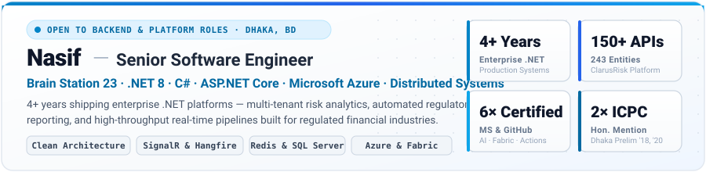
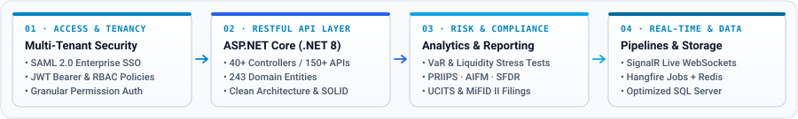

<!-- CUSTOM LIGHT-MODE EXECUTIVE HERO BANNER -->

<!-- SINGLE-LINE ANIMATED TYPING SUBTITLE (NO CLIPPING) -->

<!-- LIGHT-MODE SOCIAL & NAVIGATION BAR -->

  
  
  
  
  

---

### 🏛️ Enterprise Engineering Spotlight — **MJH Risk Monitor (ClarusRisk Dashboard)**
*Enterprise risk monitoring, quantitative analytics, and regulatory reporting platform for institutional asset managers at **[Brain Station 23](https://brainstation-23.com)**. I care about clean architecture, predictable performance, and systems that survive real-world production load.*

  

<b>🔍 Expand Full Engineering Scope &amp; Production Details (.NET 8 · SignalR · Hangfire · Redis · SQL Server)</b>

 

- **Quantitative Risk Analytics:** Engineered VaR modeling, liquidity stress testing, and real-time portfolio monitoring across **243 domain entities**.
- **Automated Regulatory Reporting:** Built compliance and reporting pipelines for **PRIIPS, AIFM, SFDR, UCITS, and MiFID II**.
- **Real-Time & Background Processing:** High-volume bulk processing powered by **SignalR WebSockets** and **Hangfire** background jobs backed by **Redis**.
- **Enterprise API & Security:** **RESTful API with 40+ controllers and 150+ endpoints**; multi-tenant architecture secured with **SAML 2.0 SSO**, **JWT authentication**, permission-based authorization (**RBAC**), and a distributed **Redis caching layer**.

---

### 🚀 Featured Projects

<table>
  <tr>
    <td width="50%" valign="top">
      <b>⚡ <a href="https://github.com/oii-nasif/Caching-in-Clean-Architecture-DotNet">Caching in Clean Architecture (.NET)</a></b> 
      Cache contract in the application layer, Redis and in-memory implementations in infrastructure, consumed transparently via a MediatR pipeline behavior with a marker-interface opt-in.
        
      
      
      
      
      

        
<b>📐 Architecture Highlights</b>

        
          • Strict separation of concerns between Application abstractions and Infrastructure providers. 
          • Non-intrusive cross-cutting caching via MediatR pipeline behaviors. 
          • Focus: performance, maintainability, and production-ready .NET patterns.
        
      

    </td>
    <td width="50%" valign="top">
      <b>🧬 <a href="https://github.com/oii-nasif/Predicting-Anti-Cancer-Peptides">Predicting Anti-Cancer Peptides</a></b> 
      Applied machine learning research project combining bioinformatics feature engineering and supervised predictive modeling on biological peptide datasets.
        
      
      
      
      

        
<b>🔬 Methodology Highlights</b>

        
          • Sequence preprocessing and feature extraction across biological peptide datasets. 
          • Supervised classification pipeline built and evaluated with scikit-learn. 
          • Focus: Python, scikit-learn, data preprocessing, and model evaluation.
        
      

    </td>
  </tr>
</table>

---

### 🛠️ Technology Stack & Engineering Practices

<table>
  <tr>
    <td width="50%" valign="top">
      <h4>⚙️ Primary Stack (.NET &amp; Backend)</h4>
      

      <ul>
        <li><b>Core &amp; Web:</b> .NET 8, C#, ASP.NET Core (Web API, MVC)</li>
        <li><b>Architecture:</b> Clean Architecture, SOLID, Dependency Injection, MediatR</li>
        <li><b>Data &amp; Caching:</b> Entity Framework Core, Dapper, In-Memory &amp; Redis Caching</li>
        <li><b>Real-Time &amp; Jobs:</b> SignalR WebSockets, Hangfire Background Processing</li>
        <li><b>Identity &amp; Auth:</b> JWT, ASP.NET Identity, SAML 2.0 SSO, RBAC</li>
      </ul>
    </td>
    <td width="50%" valign="top">
      <h4>☁️ Cloud, DevOps &amp; Quality (Azure)</h4>
      

      <ul>
        <li><b>Microsoft Azure:</b> App Services, Azure Functions, Storage, Azure AI Services</li>
        <li><b>CI/CD &amp; Automation:</b> GitHub Actions (Certified), Azure DevOps, Git, Bash</li>
        <li><b>Observability:</b> Serilog, Azure Application Insights</li>
        <li><b>Security &amp; Testing:</b> Secure Config &amp; Secrets Management, xUnit, NUnit, Moq</li>
      </ul>
    </td>
  </tr>
  <tr>
    <td width="50%" valign="top">
      <h4>🗄️ Databases &amp; Data Engineering</h4>
      

      <ul>
        <li><b>SQL Server:</b> Query optimization, indexing, transactions, stored procedures, performance tuning</li>
        <li><b>Relational &amp; NoSQL:</b> PostgreSQL, MySQL, Redis</li>
        <li><b>Data Platform:</b> Microsoft Fabric (Certified Data Engineer Associate)</li>
      </ul>
    </td>
    <td width="50%" valign="top">
      <h4>🌐 Frontend, Applied ML &amp; Exploring</h4>
      

      <ul>
        <li><b>Frontend (Working Knowledge):</b> Angular (API integration, forms, state handling), TypeScript, JavaScript (ES6+)</li>
        <li><b>ML &amp; Algorithms:</b> Python (ML &amp; research projects), Algorithmic problem-solving (ICPC)</li>
        <li><b>🔭 Currently Exploring:</b> AI Agents &amp; Azure AI, Microsoft Fabric Lakehouses, Distributed Event Pipelines, Modern CI/CD Workflows</li>
      </ul>
    </td>
  </tr>
</table>

---

### 🏅 Certifications, Competitive Programming & Community

<table>
  <tr>
    <td width="56%" valign="top">
      <h4>📜 Microsoft, GitHub &amp; AI Certifications</h4>
      <ul>
        <li><a href="https://learn.microsoft.com/en-us/users/oii-nasif/credentials/940600B6FFE01880"><b>GH-200</b> – GitHub Certified: GitHub Actions</a> · Sep 2026</li>
        <li><a href="https://learn.microsoft.com/en-us/users/oii-nasif/credentials/81a97e0d63c1d08c"><b>DP-700</b> – Microsoft Certified: Fabric Data Engineer Associate</a> · May 2026</li>
        <li><a href="https://learn.microsoft.com/en-us/users/oii-nasif/credentials/d748907356a2edaa"><b>AI-102</b> – Microsoft Certified: Azure AI Engineer Associate</a> · Jun 2024</li>
        <li><a href="https://learn.microsoft.com/en-us/users/oii-nasif/credentials/2455e35496ab3880"><b>AI-900</b> – Microsoft Certified: Azure AI Fundamentals</a> · Dec 2023</li>
        <li><a href="https://learn.microsoft.com/en-us/users/oii-nasif/credentials/26a71372456bd6b4"><b>AZ-900</b> – Microsoft Certified: Azure Fundamentals</a> · May 2023</li>
        <li><a href="https://www.credly.com/badges/ecf6563e-204f-4abc-b61d-5294b5051287/"><b>DP-900</b> – Microsoft Certified: Azure Data Fundamentals</a> · Oct 2022</li>
        <li><a href="https://www.kaggle.com/certification/badges/nasifishtiaqueislam/108"><b>Kaggle × Google</b> – 5-Day AI Agents Intensive</a> · Jul 2026</li>
      </ul>
    </td>
    <td width="44%" valign="top">
      <h4>🏆 Competitive Programming &amp; Leadership</h4>
      <ul>
        <li><b>Honorable Mention</b>, ICPC Asia Dhaka Regional Online Preliminary (2018, 2020) — <a href="https://icpc.global/ICPCID/ENEK9F08IH5R">ICPC Profile ↗</a></li>
        <li><b>Champion</b>, ICT Olympiad, UIU CSE FEST 2017</li>
        <li><b>Mentor (.NET)</b>, Geeky Solutions</li>
        <li><b>President</b>, UIU Science Forum (2019 – 2021)</li>
      </ul>
      <i>Focused on cloud platforms, data engineering, CI/CD, and applied AI on Azure.</i>
    </td>
  </tr>
</table>

---

### 📊 GitHub Activity & Statistics

  

    
    
  

  

    
  

---

  <b>💬 Open to collaboration, technical discussions, and challenging backend &amp; platform engineering problems.</b> 
  
    <a href="https://www.nasif.tech">🌐 www.nasif.tech</a> ·
    <a href="https://bd.linkedin.com/in/oii-nasif">💼 LinkedIn</a> ·
    <a href="https://github.com/oii-nasif">🐙 GitHub</a> ·
    <a href="mailto:nasif.ishtiaque.islam@gmail.com">✉️ nasif.ishtiaque.islam@gmail.com</a>
  

