

  <a href="https://www.nasif.tech"><picture><source media="(prefers-color-scheme: dark)" srcset="assets/hero-dark.svg"></picture></a>

  <a href="https://www.nasif.tech"><picture><source media="(prefers-color-scheme: dark)" srcset="assets/link-site-dark.svg"></picture></a>
  <a href="https://www.nasif.tech/resume/"><picture><source media="(prefers-color-scheme: dark)" srcset="assets/link-resume-dark.svg"></picture></a>
  <a href="https://www.nasif.tech/blog/"><picture><source media="(prefers-color-scheme: dark)" srcset="assets/link-blog-dark.svg"></picture></a>
  <a href="https://bd.linkedin.com/in/oii-nasif"><picture><source media="(prefers-color-scheme: dark)" srcset="assets/link-linkedin-dark.svg"></picture></a>
  <a href="mailto:nasif.ishtiaque.islam@gmail.com"><picture><source media="(prefers-color-scheme: dark)" srcset="assets/link-email-dark.svg"></picture></a>

  Software engineer with 4+ years shipping enterprise .NET systems for regulated industries. 
  Multi-tenant risk analytics, regulatory reporting and real-time pipelines. 
  I care about architecture, performance, and code that survives real-world abuse.

 

  <picture><source media="(prefers-color-scheme: dark)" srcset="assets/h-experience-dark.svg"></picture>
  <a href="https://www.nasif.tech/experience/"><picture><source media="(prefers-color-scheme: dark)" srcset="assets/career-dark.svg"></picture></a>

<b>The same five years, in words</b>

 

| | Role | What I did |
|---|---|---|
| **Oct 2026 – now** | Senior Software Engineer I | Leading backend development of ClarusRisk Dashboard (MJH Risk Monitor), an enterprise risk monitoring and portfolio management platform for institutional asset managers. |
| **Jul 2024 – Sep 2026** | Software Engineer II | Built the same platform from its early build-out through its first production releases: the REST API, custom JWT authentication, multi-tenancy with SAML 2.0 SSO and RBAC, and the Redis caching layer. |
| **Jul 2023 – Jun 2024** | Associate Software Engineer (IC1B) | Web applications for US law enforcement (SAFVIC, LEADRS) on ASP.NET and Entity Framework. Improved load times and resolved critical production issues. |
| **Oct 2022 – Jun 2023** | Associate Software Engineer (IC1A) | Feature work and query optimization on enterprise web applications. |
| **Jan 2022 – Sep 2022** | Trainee Software Engineer | The full lifecycle, from requirements to deployment, building modules in ASP.NET and Entity Framework. |

Before Brain Station 23: Bengali language consultant for what3words (contract, Jun 2021).

 

  <picture><source media="(prefers-color-scheme: dark)" srcset="assets/h-flagship-dark.svg"></picture>
  <a href="https://www.nasif.tech/projects/risk-monitor/"><picture><source media="(prefers-color-scheme: dark)" srcset="assets/flagship-dark.svg">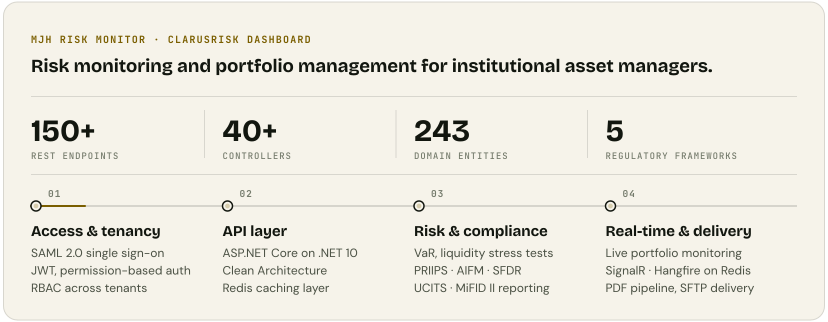</picture></a>

<b>Engineering scope</b>

 

A client platform built at [Brain Station 23](https://brainstation-23.com). The code is private; this is what I can say about it.

- **Risk analytics.** VaR modeling, liquidity stress testing and real-time portfolio monitoring across 243 domain entities.
- **Regulatory reporting.** Automated reports for PRIIPS, AIFM, SFDR, UCITS and MiFID II.
- **Real-time and background work.** Bulk processing over SignalR WebSockets, with Hangfire jobs backed by Redis.
- **API and security.** A REST API of 40+ controllers and 150+ endpoints, with custom JWT authentication and permission-based authorization. Multi-tenant, with SAML 2.0 SSO and RBAC, behind a Redis caching layer.
- **Delivery.** Secure SFTP file distribution and an Aspose-based pipeline that generates and merges PDFs.

Stack: .NET 10, ASP.NET Core, SignalR, Hangfire, Redis, SQL Server. There is a longer write-up at [nasif.tech/projects/risk-monitor](https://www.nasif.tech/projects/risk-monitor/).

 

  <picture><source media="(prefers-color-scheme: dark)" srcset="assets/h-projects-dark.svg"></picture>
  <a href="https://github.com/oii-nasif/ChartWell"><picture><source media="(prefers-color-scheme: dark)" srcset="assets/project-chartwell-dark.svg">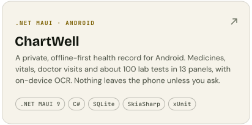</picture></a>
  <a href="https://github.com/oii-nasif/WednesdayUnited"><picture><source media="(prefers-color-scheme: dark)" srcset="assets/project-wednesday-united-dark.svg"></picture></a>
  <a href="https://github.com/oii-nasif/SentinelOps-AI"><picture><source media="(prefers-color-scheme: dark)" srcset="assets/project-sentinelops-dark.svg"></picture></a>
  <a href="https://github.com/oii-nasif/misconfigured-dp700"><picture><source media="(prefers-color-scheme: dark)" srcset="assets/project-misconfigured-dark.svg"></picture></a>

  <b>Try them:</b>
  <a href="https://wednesdayunited.me">wednesdayunited.me</a> ·
  <a href="https://sentinelops-ai-849282414521.asia-southeast1.run.app">SentinelOps AI</a> ·
  <a href="https://oii-nasif.github.io/misconfigured-dp700/">Misconfigured</a> 
  <b>Also here:</b>
  <a href="https://github.com/oii-nasif/Caching-in-Clean-Architecture-DotNet">Caching in Clean Architecture</a> ·
  <a href="https://github.com/oii-nasif/Snapture">Snapture</a> ·
  <a href="https://github.com/oii-nasif/the-monsters-changed-powerbi">The Monsters Changed</a>

 

  <picture><source media="(prefers-color-scheme: dark)" srcset="assets/h-stack-dark.svg"></picture>
  <picture><source media="(prefers-color-scheme: dark)" srcset="assets/stack-backend-dark.svg">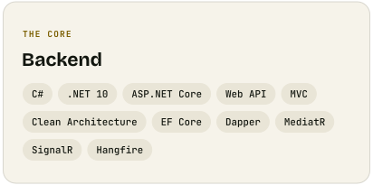</picture>
  <picture><source media="(prefers-color-scheme: dark)" srcset="assets/stack-data-dark.svg">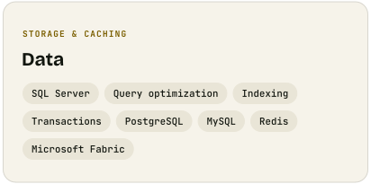</picture>
  <picture><source media="(prefers-color-scheme: dark)" srcset="assets/stack-cloud-dark.svg">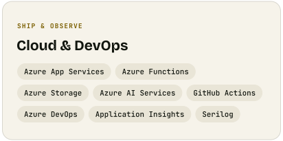</picture>
  <picture><source media="(prefers-color-scheme: dark)" srcset="assets/stack-edges-dark.svg">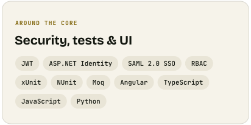</picture>

 

  <picture><source media="(prefers-color-scheme: dark)" srcset="assets/h-credentials-dark.svg"></picture>
  <a href="https://learn.microsoft.com/en-us/users/oii-nasif/credentials/940600B6FFE01880"><picture><source media="(prefers-color-scheme: dark)" srcset="assets/cred-gh-200-dark.svg">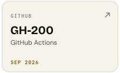</picture></a>
  <a href="https://learn.microsoft.com/en-us/users/oii-nasif/credentials/81a97e0d63c1d08c"><picture><source media="(prefers-color-scheme: dark)" srcset="assets/cred-dp-700-dark.svg">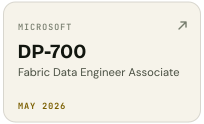</picture></a>
  <a href="https://learn.microsoft.com/en-us/users/oii-nasif/credentials/d748907356a2edaa"><picture><source media="(prefers-color-scheme: dark)" srcset="assets/cred-ai-102-dark.svg">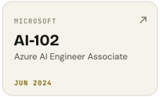</picture></a>
  <a href="https://learn.microsoft.com/en-us/users/oii-nasif/credentials/2455e35496ab3880"><picture><source media="(prefers-color-scheme: dark)" srcset="assets/cred-ai-900-dark.svg">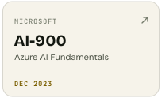</picture></a>
  <a href="https://learn.microsoft.com/en-us/users/oii-nasif/credentials/26a71372456bd6b4"><picture><source media="(prefers-color-scheme: dark)" srcset="assets/cred-az-900-dark.svg">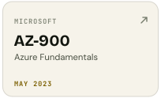</picture></a>
  <a href="https://www.credly.com/badges/ecf6563e-204f-4abc-b61d-5294b5051287/"><picture><source media="(prefers-color-scheme: dark)" srcset="assets/cred-dp-900-dark.svg">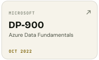</picture></a>
  <a href="https://www.kaggle.com/certification/badges/nasifishtiaqueislam/108"><picture><source media="(prefers-color-scheme: dark)" srcset="assets/cred-kaggle-agents-dark.svg">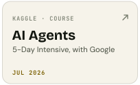</picture></a>
  <a href="https://icpc.global/ICPCID/ENEK9F08IH5R"><picture><source media="(prefers-color-scheme: dark)" srcset="assets/cred-icpc-dark.svg">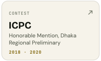</picture></a>

  <b>BSc, Computer Science &amp; Engineering</b> · United International University, 2017 – 2021 
  Merit scholarship, three times · Champion, ICT Olympiad (UIU CSE Fest 2017) · President, UIU Science Forum, 2019 – 2021 · Mentor (.NET), Geeky Solutions

 

  <picture><source media="(prefers-color-scheme: dark)" srcset="assets/h-github-dark.svg"></picture>
  <picture><source media="(prefers-color-scheme: dark)" srcset="assets/gh-activity-dark.svg"></picture>
  <picture><source media="(prefers-color-scheme: dark)" srcset="assets/gh-streak-dark.svg"></picture>
  <picture><source media="(prefers-color-scheme: dark)" srcset="assets/gh-totals-dark.svg">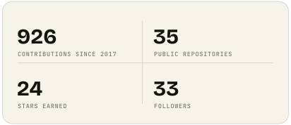</picture>

 

  <picture><source media="(prefers-color-scheme: dark)" srcset="assets/h-writing-dark.svg"></picture>

<!-- writing:start -->

  <a href="https://www.nasif.tech/blog/ai-productivity-speed-data/"><picture><source media="(prefers-color-scheme: dark)" srcset="assets/post-1-dark.svg">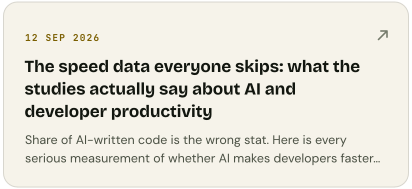</picture></a>
  <a href="https://www.nasif.tech/blog/caching-clean-architecture/"><picture><source media="(prefers-color-scheme: dark)" srcset="assets/post-2-dark.svg">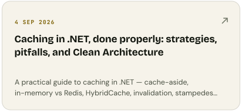</picture></a>

<!-- writing:end -->

 

  <a href="mailto:nasif.ishtiaque.islam@gmail.com"><picture><source media="(prefers-color-scheme: dark)" srcset="assets/closing-dark.svg">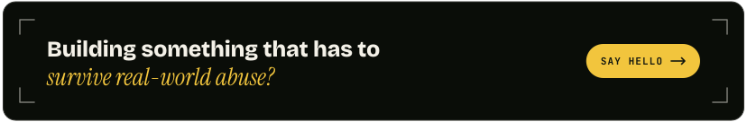</picture></a>

  <a href="https://www.nasif.tech">nasif.tech</a> ·
  <a href="https://bd.linkedin.com/in/oii-nasif">LinkedIn</a> ·
  <a href="mailto:nasif.ishtiaque.islam@gmail.com">nasif.ishtiaque.islam@gmail.com</a> 
  Off the clock I <a href="https://www.nasif.tech/photography/">photograph birds</a> and <a href="https://www.nasif.tech/running/">run road races</a>. 
  Every graphic here is drawn by <a href="https://github.com/oii-nasif/oii-nasif/tree/master/scripts">a script in this repo</a> and refreshed daily by GitHub Actions. No third-party widgets.

